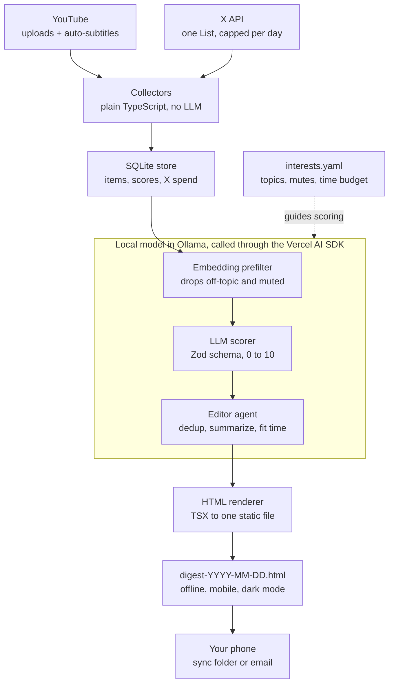

# Digister: local morning digest plan

Plan v1, 2026-10-30. Live version with comments: [Claude Doc](https://claude.ai/artifact/QMVc8P7TJGSUGE1p5nCoZ6).

## Summary

Build Digister as a Node/TypeScript app on the Vercel AI SDK, talking to a local Ollama model, that runs at about 5:30 each morning and writes one self-contained HTML page you read offline on your commute. It pulls new videos from your YouTube subscriptions (free) and posts from a curated X List (paid per post read, so it is capped), stores everything in SQLite, scores each item against an interests file you write, summarizes the keepers, and drops `digest-YYYY-MM-DD.html` into a folder that syncs to your phone.

Three choices drive the plan:

- **X is the expensive, fragile source.** The free tier is gone; reads are billed per post. Read a short List you curate, prefer free cross-posted feeds, and pick one paid or opt-in route for the rest (all options are compared below).
- **YouTube is cheap.** Subscriptions and new uploads fit easily in the free API quota. Transcripts are the hard part, because the official captions download only works for videos you own.
- **The agent does the editing, not the plumbing.** Fetching and storage are plain code; the LLM agent ranks, summarizes, and writes the digest. That keeps a small local model on the work it is good at.

## Data access realities

Both sources need an OAuth sign-in once, with tokens kept in the OS keychain or a local `.env` that is never committed. Only X costs money.

| Need | X (x.com) | YouTube |
| --- | --- | --- |
| Access model | Developer account, pay-per-use credits; Basic ($200/mo) and Pro are closed to new signups ([postproxy](https://www.postproxy.dev/blog/x-api-pricing-2026/)) | YouTube Data API v3, free, Google Cloud project + OAuth consent screen in testing mode |
| Cost | About $0.005 per post read, per third-party trackers ([posteverywhere](https://posteverywhere.ai/blog/x-twitter-api-pricing), [opentweet](https://opentweet.io/x-api-pricing)); confirm in the X Developer Console | Free within a default daily quota of 10,000 units (approximate, from memory) |
| What to read | Posts from one private X List of the 30 to 80 accounts you trust, fetched with `since_id` so each post is paid for once | `subscriptions.list` (mine) for your channels, then each channel's uploads playlist via `playlistItems.list`, then `videos.list` for duration and stats |
| Interest signals | Your bookmarks and likes (owned reads, cheaper than public reads) | Your liked videos (`videos.list` with `myRating=like`) |
| What to avoid | The algorithmic home timeline (most of what you quit), unless you opt in, cookie or scraping routes (see Every way to read X) | `search.list` (about 100 units a call); watch history and Watch Later are not exposed by the API |
| Full text | The post text, plus the thread if the author replied to themselves (extra reads) | Transcripts: the official `captions.download` only works on videos you own |

**Budget for X.** A cap of 200 new posts a day is about $1 a day, roughly $30 a month at the rate above; 100 a day halves it. Digister enforces the cap in code and logs spend per run, so a busy news day cannot surprise you.

**Transcripts for YouTube.** Use `yt-dlp --write-auto-subs --skip-download` to fetch the auto-generated subtitles as text. It is unofficial and breaks from time to time, so the fallback order is: subtitles, then the video description and chapters, then (optional, slow) downloading audio and transcribing locally with whisper.cpp. A zero-cost alternative to the API for new uploads is each channel's public RSS feed, `youtube.com/feeds/videos.xml?channel_id=…`, which uses no quota.

## Every way to read X

There are seven workable routes and one dead one; Digister should treat them as interchangeable collectors behind one `XSource` interface, so you can switch when prices or breakage change. Prices below are vendor or blog figures, normalized to 1,000 posts read.

| Option | How it works | Cost per 1,000 posts | Risk and upkeep |
| --- | --- | --- | --- |
| Official X API | Pay-per-use credits, OAuth on your account, read a List with `since_id` | About $5 ([posteverywhere](https://posteverywhere.ai/blog/x-twitter-api-pricing)) | Allowed by X's terms; stable; the only fully compliant route |
| Third-party read APIs | A vendor scrapes X and sells a REST API: [twitterapi.io](https://twitterapi.io/) (about $0.15), SocialData (about $0.20), GetXAPI (about $0.05, its own claim), Apify actors ($0.40 to $1.50) ([GetXAPI ranking](https://www.getxapi.com/blogs/cheapest-twitter-api-2026-8-providers-ranked-by-real-per-1000-tweet-cost), [xpoz](https://www.xpoz.ai/blog/comparisons/best-twitter-api-alternatives-2026/)) | $0.05 to $1.50 | Your X account is never touched; the vendor is in a grey area with X and can vanish or change price |
| Browser-session cookies | Reuse the `auth_token` and `ct0` cookies of your logged-in browser and call X's web endpoints. This is OpenClaw's "bird" skill ([listing](https://playbooks.com/skills/z980944038-dev/openclawwdl/bird-1.0.0)); in Python, [twscrape](https://scrapfly.io/blog/posts/best-twitter-scrapers-github) or twikit forks | Free | Against X's terms; your account can be rate-limited or locked; breaks when X changes its web app (twikit 2.3.3 broke in 2026 and needed a fork, per [twifork](https://pypi.org/project/twifork/)) |
| RSSHub, self-hosted | Runs locally and turns X profiles and Lists into RSS, using an `auth_token` cookie or X API keys ([GetXAPI article](https://www.getxapi.com/blogs/twitter-rss-feed), unverified against RSSHub docs) | Free with cookies, API price with keys | Same risk as cookies when used with them; an extra service to keep running; gives plain RSS any reader can use |
| Browser automation | Playwright drives a real browser profile you are logged into, opens your List, scrolls, and extracts posts; an LLM browser agent could do the same | Free | Slowest and most fragile; bot detection; same terms issue; useful as a last resort |
| Follow them elsewhere | Many X authors cross-post to Bluesky, Mastodon, Threads, Substack, or a blog. Bluesky's AT Protocol API is free and open, and Mastodon, Substack, and blogs publish RSS | Free | Fully allowed and stable; only covers people who cross-post |
| Paste-in links | Share a post URL to a Digister inbox (an email address or a notes file) when someone sends you one; Digister fetches and summarizes it | Free or cents | No risk; covers only what reaches you some other way |
| Nitter | The open-source X front end | Not viable | The repo was archived on Aug 26, 2026 and public instances return errors ([Nitter wiki](https://github.com/zedeus/nitter/wiki/Creating-session-tokens/7e06d8c4b6df31111ccce6a7d2b20fe724964d81), [GetXAPI article](https://www.getxapi.com/blogs/twitter-rss-feed)) |

**Recommended mix.** First, map each account on your List to a cross-posted feed where one exists, which is free and safe. Fetch the rest through one paid route: a third-party read API keeps 200 posts a day under a dollar a month, and the official API is the choice if you want zero grey area. Ship the cookie collector too, off by default, read-only, one fetch per morning, with a clear warning in `digister auth`, because it is the only free way to read your actual home timeline. Browser automation stays a documented fallback, not a default.

## Every way to read YouTube

YouTube splits into two jobs, finding new videos and getting their words, and each has free options. All of these are free in money; they differ in sign-in and fragility.

| Job | Option | How it works | Risk and upkeep |
| --- | --- | --- | --- |
| Find new videos | YouTube Data API v3 | OAuth once; `subscriptions.list` then each channel's uploads playlist | Official and stable; daily quota is plenty for one person |
| Find new videos | Channel RSS feeds | `youtube.com/feeds/videos.xml?channel_id=…`, about the latest 15 uploads per channel, no key | No sign-in, no quota; you keep the channel list yourself |
| Find new videos | Google Takeout | Export `subscriptions.csv` once to seed the RSS channel list | One-off and manual; rerun when you subscribe to new channels |
| Find new videos | Invidious or Piped instance | Open-source YouTube front ends with their own APIs and RSS | Public instances come and go; self-hosting is extra work |
| Get the words | `yt-dlp` subtitles | Download auto-generated or uploaded subtitles without the video | Unofficial; update it often as YouTube changes |
| Get the words | Transcript libraries | `youtube-transcript-api` (Python) or a Node equivalent fetch the same captions directly | Unofficial; can be rate-limited from one IP |
| Get the words | Local Whisper | Download audio with `yt-dlp`, transcribe with whisper.cpp or faster-whisper | Works when no captions exist; slow without a GPU |
| Get the words | Description and chapters | Use the text the creator wrote | Always available; thin for long videos |
| Get the words | Official `captions.download` | Data API call | Only for videos you own, so not usable here |

**Recommended mix.** Seed the channel list from the Data API (or Takeout), then poll channel RSS each morning, which needs no quota or token refresh. Get words with `yt-dlp` first, a transcript library second, the description third, and Whisper only for videos you mark as must-read.

## Agent SDK: OpenAI Agents SDK vs Vercel AI SDK

Recommendation: the Vercel AI SDK in TypeScript. Ollama is a first-class provider there rather than a compatibility shim, structured output with Zod is its strongest feature, and nothing phones home. Pick the OpenAI Agents SDK instead if you would rather write Python, since Python has the better YouTube transcript tooling.

|  | OpenAI Agents SDK | Vercel AI SDK |
| --- | --- | --- |
| Languages | Python (most mature) and TypeScript | TypeScript / JavaScript |
| How it talks to Ollama | Point `OpenAIChatCompletionsModel` at Ollama's OpenAI-compatible endpoint (`http://localhost:11434/v1`, dummy key), or use the LiteLLM extension (`LitellmModel`) | A provider package (community `ollama-ai-provider-v2` / `ai-sdk-ollama`) or `@ai-sdk/openai-compatible` pointed at the same endpoint; you swap one line to change models |
| Agent model | `Agent` + `Runner` with tools, handoffs between agents, guardrails, sessions | `ToolLoopAgent` (AI SDK 6) or `generateText` with tools and a step limit; you compose multi-agent flows yourself ([AI SDK 6](https://vercel.com/blog/ai-sdk-6)) |
| Structured output | Pydantic `output_type`; depends on the local model following JSON well | Zod schemas via `generateObject` / output specs, with validation and retries built in |
| Local-first fit | Tracing uploads to OpenAI by default; you must turn it off for a local app. Responses API and hosted tools are OpenAI-only ([review](https://rywalker.com/research/openai-agents-sdk)) | No telemetry by default; nothing in the core assumes a hosted vendor |
| Strengths | Clean multi-agent primitives (handoffs, guardrails), built-in tracing UI if you ever use OpenAI | Excellent TypeScript types, streaming, many providers, tiny surface for a batch job |
| Weak spots for Digister | Many features you would not use; OpenAI-first defaults to undo; LiteLLM tool-format gaps reported ([forum](https://community.openai.com/t/support-for-litellm-tools-e-g-googlesearch-in-openai-agents-sdk/1240585)) | Fast-moving major versions (pin them); Ollama provider is community-maintained; YouTube transcripts in Node lean on calling `yt-dlp` |

With either SDK, small local models are the real constraint: tool calling and JSON are reliable on recent 7B to 14B models (for example Qwen 3, Llama 3.1, Gemma 3 class) but not on tiny ones. Digister keeps tool loops short and validates every structured response, retrying once before falling back to a plain summary.

## Architecture



Fetching and storage are deterministic code; only the Ollama stage calls the local model, so a model swap or an Ollama outage never touches the collectors or the store.

The editor agent is the one place the SDK's tool loop earns its keep. Its tools are `list_candidates`, `get_transcript`, `get_thread`, and `find_past_coverage` (so a story covered yesterday is skipped or marked as an update), and it returns the digest as a validated object the renderer turns into HTML.

**Data model (SQLite).** `items` holds one row per post or video: source, author, url, published time, text, transcript, embedding, topic, score, summary, and status (new, filtered, kept, published). `runs` logs each morning: start time, X reads, X cost, digest path. `feedback` records more-or-less signals per item.

**Folder layout.**

```
digister/
  src/cli.ts                 digister run | run --dry | auth
  src/collectors/youtube.ts
  src/collectors/x.ts
  src/store/db.ts            SQLite (better-sqlite3)
  src/pipeline/prefilter.ts
  src/pipeline/score.ts
  src/pipeline/editor.ts     agent + tools
  src/render/Digest.tsx
  config/interests.yaml
  out/                       digests, synced to the phone
```

## Interest filtering and summarization

You describe your interests once in `interests.yaml`; Digister ranks every new item against it in two cheap-then-careful passes and learns from what you skip.

```yaml
topics:
  - name: Local AI and agents
    weight: 1.0
    examples: ["new open-weight model releases", "agent frameworks"]
  - name: Personal finance
    weight: 0.6
always_include: ["@karpathy", "youtube:UCxxxx"]
mute: ["crypto giveaways", "engagement bait", "politics"]
max_items: 15
reading_minutes: 25
```

1. **Prefilter with embeddings.** Embed each item with a local embedding model (for example `nomic-embed-text` in Ollama) and compare it to your topic descriptions. Items far from every topic are dropped without an LLM call; muted phrases are dropped outright.
2. **Score with the LLM.** The survivors go to the chat model with a Zod schema: topic, relevance 0 to 10, a one-line reason, and whether it is news, opinion, or tutorial.
3. **Deduplicate.** Items about the same story (a launch tweeted by five accounts and covered in two videos) are clustered by embedding similarity and merged into one entry with all sources linked.
4. **Summarize the keepers.** X posts and threads get two or three sentences. Videos get a summary from the transcript, chunked to fit the model's context, plus three key points and timestamps worth jumping to.
5. **Fit the commute.** The editor agent picks the top items until the estimated reading time reaches `reading_minutes`, always including `always_include` sources.

**Feedback loop.** Each item carries "more like this" and "less like this" links. Offline on the train, they open a pre-filled email to yourself (`mailto:`); the next run reads those emails, or a later version records taps through a small local web server when you are home. Feedback nudges the weights in `interests.yaml` slowly, never rewriting what you set.

## HTML digest and getting it to your phone

Each run writes one self-contained file, `digest-YYYY-MM-DD.html`: inline CSS, no JavaScript required, no external fonts or trackers, thumbnails embedded small, so it opens instantly with no signal in a tunnel.

Layout, top to bottom:

- **Header**: date, item count, estimated reading time, and X spend for the run.
- **Top stories**: the 3 to 5 highest-scoring items, merged across sources, each with a two-sentence summary.
- **By topic**: one section per interest, each item showing source (X or YouTube), author, summary, and a link out.
- **Videos**: thumbnail, channel, duration, summary, key points, and timestamp links that open the video at the right second, so you can choose what to watch later.
- **Footer**: what was filtered out and why (counts per reason), feedback links, and a link to yesterday's digest.

Design: mobile-first single column, large readable type, system font stack, automatic dark mode via `prefers-color-scheme`, and a small table of contents with anchors for one-handed scrolling. Templates are TSX rendered to a static string (`react-dom/server`), so there is no front-end build.

**Delivery.** Write the file into a folder that syncs to your phone (iCloud Drive, Dropbox, Google Drive, or Syncthing) and open it from the Files app. Optional: also email it to yourself as an attachment so it sits in your inbox each morning. A LAN web server alone does not work on a commute.

## Scheduling on your machine

Run the whole pipeline once a day with the OS scheduler, early enough to finish before you leave, and make it safe to run again.

| OS | Scheduler | Waking a sleeping machine |
| --- | --- | --- |
| macOS | `launchd` agent (`~/Library/LaunchAgents/com.digister.plist`, `StartCalendarInterval` 05:30) | `pmset repeat wakeorpoweron MTWRFSU 05:25:00`; a laptop must be on power |
| Linux | `systemd` user timer with `Persistent=true` so a missed run catches up at boot | `rtcwake`, or leave it on |
| Windows | Task Scheduler, "Wake the computer to run this task" | Built into the task setting |

The run itself is `digister run`: check Ollama is up (start it if not), collect, filter, summarize, render, deliver. Collectors run in parallel; LLM calls run one or two at a time so a laptop GPU is not overloaded. Every step reads and writes SQLite, so a crash resumes where it stopped and items are never summarized or paid for twice. `digister run --dry` prints what it would fetch and the expected X cost without spending anything.

If the machine was off, the next run covers everything since the last successful digest, up to the X cap.

## Milestones, risks, and open questions

Build it YouTube-first, because it is free and proves the pipeline before any X spend.

1. **Skeleton**: repo setup, config, SQLite schema, Ollama health check, `digister run --dry`.
2. **YouTube collector**: OAuth, subscriptions, new uploads, transcripts via `yt-dlp`.
3. **Filter and summarize**: `interests.yaml`, embedding prefilter, scoring and summaries with Zod schemas.
4. **HTML digest**: mobile template, sync-folder delivery, a week of reading it on the commute.
5. **X collector**: developer account, X List, `since_id`, daily cap, spend log.
6. **Editor agent and dedup**: cross-source clustering, reading-time budget, feedback links.
7. **Schedule and polish**: launchd/systemd/Task Scheduler setup, retries, a short README.

**Risks**

- X pricing and terms change often; the cap and spend log limit the damage, and Digister still works with X turned off.
- `yt-dlp` subtitle fetching can break after YouTube changes; update it regularly, and fall back to descriptions.
- Small local models summarize long transcripts unevenly; chunking and a larger model on a capable machine help.
- Google OAuth apps in testing mode expire refresh tokens after about a week (from memory); publishing the app for your own account avoids re-signing in.

**Open questions**

- [ ] Node/TypeScript or Python?
- [ ] Which machine runs it (Mac, Windows, Linux), and does it have a GPU? This sets the model size.
- [ ] Monthly X budget you are comfortable with, and roughly how many accounts you follow there.
- [ ] Phone platform, so delivery uses the right sync folder.

## Sources

The official X, YouTube, OpenAI, and AI SDK docs could not be opened when this plan was written, so prices and quotas come from the pages below or from memory where marked; check the X Developer Console and Google Cloud console before relying on them.

- [X API pricing in 2026, postproxy](https://www.postproxy.dev/blog/x-api-pricing-2026/)
- [X API pricing, posteverywhere](https://posteverywhere.ai/blog/x-twitter-api-pricing)
- [X API pricing, opentweet](https://opentweet.io/x-api-pricing)
- [AI SDK 6, Vercel](https://vercel.com/blog/ai-sdk-6)
- [OpenAI Agents SDK review, Ry Walker](https://rywalker.com/research/openai-agents-sdk)
- [LiteLLM tools in the Agents SDK, OpenAI forum](https://community.openai.com/t/support-for-litellm-tools-e-g-googlesearch-in-openai-agents-sdk/1240585)
- [OpenClaw bird skill listing](https://playbooks.com/skills/z980944038-dev/openclawwdl/bird-1.0.0)
- [Best Twitter scrapers on GitHub, Scrapfly](https://scrapfly.io/blog/posts/best-twitter-scrapers-github)
- [twifork on PyPI](https://pypi.org/project/twifork/)
- [Cheapest Twitter API 2026, GetXAPI](https://www.getxapi.com/blogs/cheapest-twitter-api-2026-8-providers-ranked-by-real-per-1000-tweet-cost)
- [Best Twitter API alternatives 2026, xpoz](https://www.xpoz.ai/blog/comparisons/best-twitter-api-alternatives-2026/)
- [twitterapi.io](https://twitterapi.io/)
- [Twitter RSS feeds in 2026, GetXAPI](https://www.getxapi.com/blogs/twitter-rss-feed)
- [Nitter wiki, session tokens](https://github.com/zedeus/nitter/wiki/Creating-session-tokens/7e06d8c4b6df31111ccce6a7d2b20fe724964d81)
